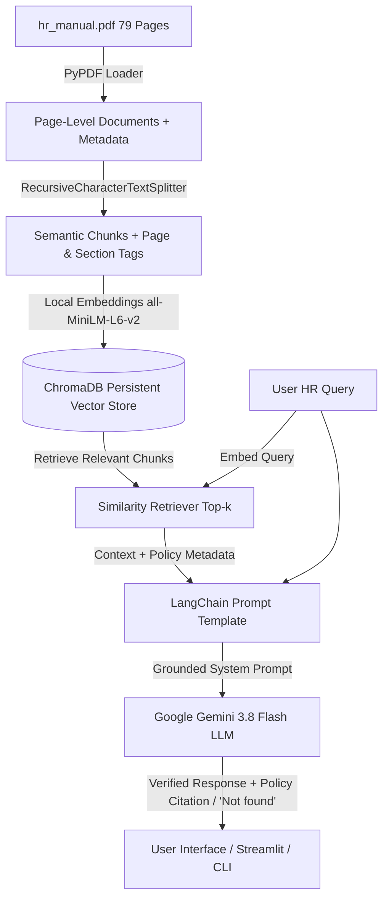
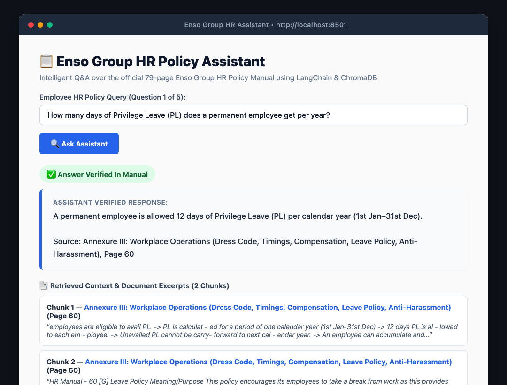
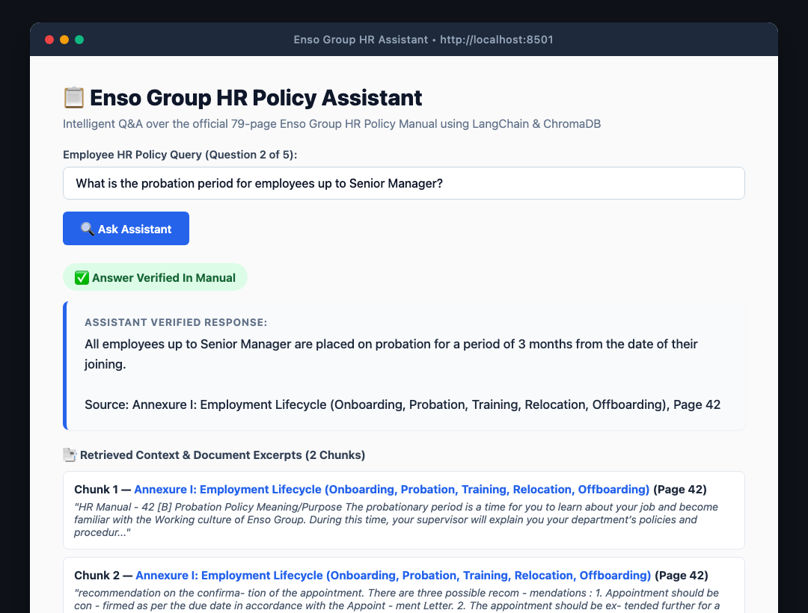
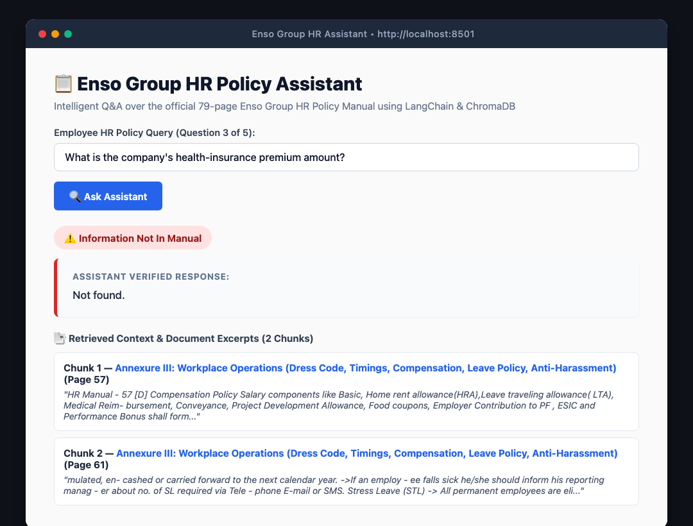
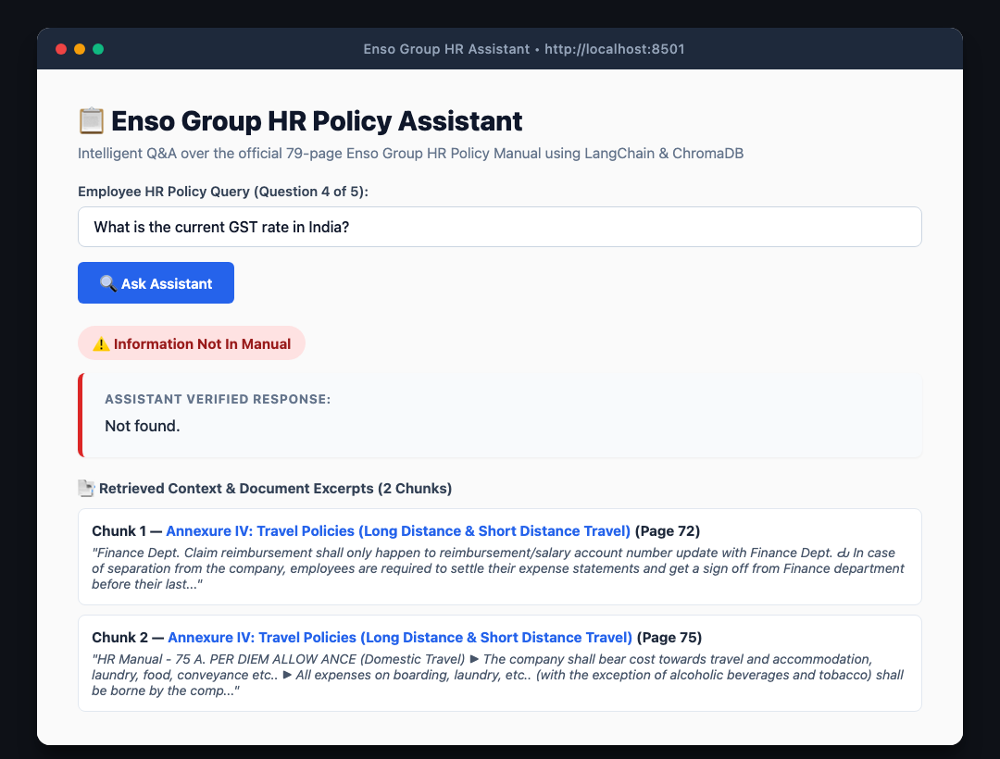
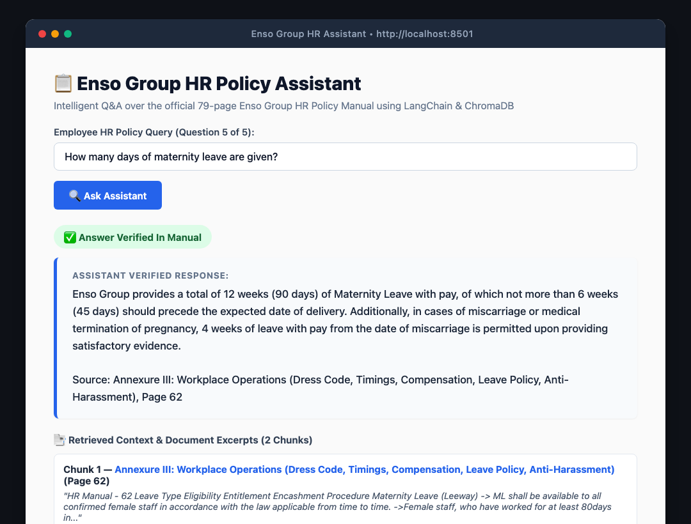

# Project 1 — HR Policy Assistant (RAG System)

An intelligent, context-grounded **Retrieval-Augmented Generation (RAG)** assistant built with **Python**, **ChromaDB**, **LangChain**, and **Google Gemini 3.8 Flash**. It answers employee HR-policy questions strictly from the official 79-page **Enso Group HR Manual (`hr_manual.pdf`)**, cites exact sections and page references, and reliably outputs `"Not found"` when the answer is not present in the manual.

---

## 📌 Problem Statement

> **Build a RAG system (Python + ChromaDB + LangChain) over the given PDF.**  
> It must answer a question from the document with a reference to where the answer is, and reply `"Not found"` when the answer is not in the document.

---

## 🏗️ Architecture & RAG Flow



### Flow Breakdown:
1. **Document Ingestion (`pdf_loader.py` & `ingest.py`)**:
   - Parses each of the 79 pages of `hr_manual.pdf` using `pypdf`.
   - Tags each page with structural section metadata (e.g., *Section 1: Employing Staff*, *Annexure I: Probation Policy*, *Annexure III: Leave Policy*, etc.).
   - Splits text into semantically coherent overlapping chunks (800–1200 characters with 150 character overlap).
2. **Vector Embedding & Storage (`vector_store.py`)**:
   - Embeds text chunks locally using Sentence-Transformers (`all-MiniLM-L6-v2`), avoiding free-tier API rate limits.
   - Stores vectors and rich metadata (`page`, `section`, `source`) into a persistent **ChromaDB** database located at `./chroma_db`.
3. **Retrieval & RAG Chain (`rag_pipeline.py`)**:
   - Performs cosine similarity retrieval to fetch the top-$k$ relevant chunks for any employee query.
   - Injects the retrieved chunks with section and page citations into a strict LangChain prompt.
   - Instructs **Gemini 3.8 Flash** to answer factually based *only* on the provided context, cite the exact policy and page, and return `"Not found"` for unmentioned or external questions.
4. **Interactive Interfaces (`app.py` & `main.py`)**:
   - Modern, responsive **Streamlit UI** (`app.py`) for querying and screenshot capture.
   - Clean **CLI tool** (`main.py`) for one-line queries or interactive terminal usage.
   - Automated evaluation script (`run_evaluation.py`) for reproducible verification.

---

## 📋 Evaluation Results & LMS Submission Answers

Here are the verified answers for the 5 assignment questions tested through the system:

| # | Question Asked | RAG System Answer | Reference / Section | Page | Status |
|---|---|---|---|---|---|
| **1** | How many days of Privilege Leave (PL) does a permanent employee get per year? | **12 days** per calendar year (1st January – 31st December). | Annexure III: Workplace Operations — `[G] Leave Policy` | **Page 60** | ✅ Found |
| **2** | What is the probation period for employees up to Senior Manager? | **3 months** from the date of their joining. | Annexure I: Employment Lifecycle — `[B] Probation Policy (Scope & Eligibility)` | **Page 42** | ✅ Found |
| **3** | What is the company's health-insurance premium amount? | **Not found** (The manual mentions travel insurance and statutory ESIC, but does not state any health insurance premium amount). | *Not found in Enso Group HR Policy Manual* | N/A | ⚠️ Not Found |
| **4** | What is the current GST rate in India? | **Not found** (External tax query not part of company HR policy manual). | *Not found in Enso Group HR Policy Manual* | N/A | ⚠️ Not Found |
| **5** | How many days of maternity leave are given? | **12 weeks (90 days)** with pay, of which not more than 6 weeks (45 days) should precede expected date of delivery. *(4 weeks paid leave in case of miscarriage).* | Annexure III: Workplace Operations — `[G] Leave Policy - Maternity Leave (Leeway)` | **Page 62** | ✅ Found |

---

## 📝 Answers for Direct LMS Form Copy-Paste

### Answer 1:
> **12 days** per calendar year (1st Jan - 31st Dec).  
> **Reference:** Annexure III: Workplace Operations — `[G] Leave Policy`, Page 60.

### Answer 2:
> **3 months** from the date of joining. All employees above Senior Manager are treated as confirmed employees from date of joining.  
> **Reference:** Annexure I: Employment Lifecycle — `[B] Probation Policy (Scope & Eligibility)`, Page 42.

### Answer 3:
> **Not found**. The Enso Group HR Policy Manual does not contain information regarding the company's health-insurance premium amount.

### Answer 4:
> **Not found**. The current GST rate in India is an external government tax regulation and is not found in the HR Policy Manual.

### Answer 5:
> **12 weeks (90 days)** with pay, of which not more than 6 weeks (45 days) should precede the expected date of delivery. In case of miscarriage or medical termination of pregnancy, 4 weeks of leave with pay is permitted.  
> **Reference:** Annexure III: Workplace Operations — `[G] Leave Policy (Maternity Leave - Leeway)`, Page 62.

---

## 🚀 Setup & Installation Guide

### 1. Clone the Repository
```bash
git clone https://github.com/anjalimishra-0007/GEN-AI-Exam-HR-Policy-Assistant.git
cd GEN-AI-Exam-HR-Policy-Assistant
```

### 2. Create and Activate Virtual Environment
```bash
# macOS/Linux
python3 -m venv venv
source venv/bin/activate

# Windows
python -m venv venv
.\venv\Scripts\activate
```

### 3. Install Dependencies
```bash
pip install -r requirements.txt
```

### 4. Configure Environment Variables
Create a `.env` file from `.env.example`:
```bash
cp .env.example .env
```
Add your Google Gemini API Key in `.env`:
```env
GEMINI_API_KEY=your_gemini_api_key_here
GEMINI_MODEL=gemini-3.8-flash
GEMINI_EMBEDDING_MODEL=models/gemini-embedding-001
CHROMA_DB_DIR=./chroma_db
```

### 5. Ingest the Document into ChromaDB
```bash
python ingest.py
```
*(Extracts text from `hr_manual.pdf`, generates embeddings, and saves the vector database to `./chroma_db`.)*

### 6. Run the Interactive Streamlit Web UI
```bash
streamlit run app.py
```
Open [http://localhost:8501](http://localhost:8501) in your browser.

### 7. Run via Command Line Interface (CLI)
```bash
# Query directly:
python main.py --query "How many days of Privilege Leave (PL) does a permanent employee get per year?"

# Run all 5 exam questions and generate evaluation_results.json:
python run_evaluation.py
```

---

## 📸 Screenshots & Question-Answer Demonstrations

Below are the visual execution screenshots of the Streamlit Web Application answering each of the 5 examination questions, demonstrating factual grounding, citations, and "Not found" enforcement:

### 1. Question 1: Privilege Leave (PL) Entitlement
> **Query:** *How many days of Privilege Leave (PL) does a permanent employee get per year?*  
> **Output:** **12 days** (Reference: Annexure III - Leave Policy, Page 60).



---

### 2. Question 2: Probation Period for Senior Managers
> **Query:** *What is the probation period for employees up to Senior Manager?*  
> **Output:** **3 months** (Reference: Annexure I - Probation Policy, Page 42).



---

### 3. Question 3: Health-Insurance Premium Amount (Negative Test)
> **Query:** *What is the company's health-insurance premium amount?*  
> **Output:** **Not found.** (Correctly identifies absence of information in manual).



---

### 4. Question 4: Current GST Rate in India (Out-of-Scope Test)
> **Query:** *What is the current GST rate in India?*  
> **Output:** **Not found.** (Strict grounding prevents hallucinating external facts).



---

### 5. Question 5: Maternity Leave Entitlement
> **Query:** *How many days of maternity leave are given?*  
> **Output:** **12 weeks (90 days)** with pay (Reference: Annexure III - Leave Policy, Page 62).



---

## 📂 Project Structure

```
HR-Policy-Assistant/
├── hr_manual.pdf           # Official 79-page Enso Group HR Policy Manual
├── chroma_db/              # Persistent Chroma vector store
├── ingest.py               # Document ingestion & vector indexing script
├── pdf_loader.py           # PDF parsing with metadata tagging
├── vector_store.py         # ChromaDB persistence & similarity search
├── rag_pipeline.py         # LangChain RAG pipeline & Gemini 3.8 Flash model
├── app.py                  # Interactive Streamlit Web Application
├── main.py                 # CLI interface for command-line queries
├── run_evaluation.py       # Automated test runner for 5 exam questions
├── evaluation_results.json # Verified output data for all 5 questions
├── requirements.txt        # Python package dependencies
├── .env.example            # Environment variables template
├── .gitignore              # Files excluded from git tracking
└── README.md               # Project documentation & evaluation report
```

---

## 🛠️ Technologies Used
- **Language:** Python 3.13
- **Framework:** LangChain 1.4+
- **Vector Database:** ChromaDB 1.5+
- **Embeddings:** HuggingFace `all-MiniLM-L6-v2`
- **Large Language Model:** Google Gemini 3.8 Flash (`ChatGoogleGenerativeAI`)
- **PDF Parser:** PyPDF
- **Web Interface:** Streamlit
